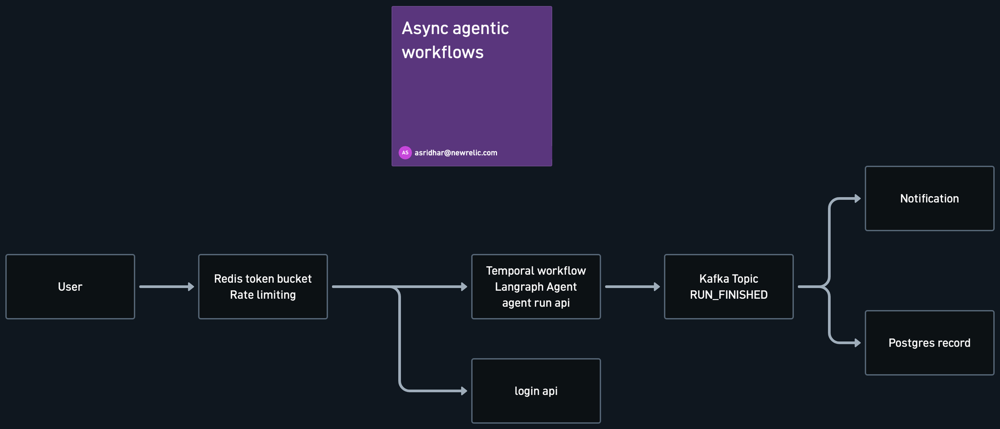

# Async Agentic Workflows

Run LangGraph agents as durable, asynchronous Temporal workflows. Requests pass through a Redis token-bucket rate limiter, are authenticated through a login API, and emit a `RUN_FINISHED` event to Kafka when the agent finishes. Consumers of that event send a notification and write a Postgres record.



```
User ─▶ Redis token bucket ─┬─▶ Temporal workflow ──▶ Kafka topic ─┬─▶ Notification
        rate limiting       │   LangGraph agent       RUN_FINISHED  └─▶ Postgres record
                            │   agent run API
                            └─▶ Login API
```

## Phases

| # | Phase | Status |
|---|-------|--------|
| 1 | [Simple LangGraph agent with one tool](docs/phases/phase-1-langgraph-agent.md) | ✅ done |
| 2 | [Infrastructure in Docker Compose](docs/phases/phase-2-infrastructure.md) | ✅ done |
| 3 | [Temporal workflow + agent run API](docs/phases/phase-3-temporal.md) (+ Tilt dev loop) | ✅ done |
| 4 | [Kafka producer and consumers](docs/phases/phase-4-kafka.md) | ⏳ |
| 5 | [Login API](docs/phases/phase-5-login-api.md) | ⏳ |
| 6 | [Redis token-bucket rate limiting](docs/phases/phase-6-rate-limiting.md) | ⏳ |

## Quick start

Requires Python 3.13, [uv](https://docs.astral.sh/uv/) and Docker.

```bash
cp .env.example .env        # fill in OPENAI_API_KEY (and OPENAI_BASE_URL for a gateway)
uv sync
```

**With Tilt** (recommended; `brew install tilt`): one command runs the infra, worker and API, with a dashboard at http://localhost:10350:

```bash
tilt up
```

**Without Tilt:**

```bash
make up && make smoke       # Postgres, Temporal (+UI :8233), Kafka (+UI :8081), Redis
uv run worker               # terminal 1
uv run uvicorn agentic_workflows.api.main:app --port 8000   # terminal 2
```

Start a run, then poll it:

```bash
curl -XPOST localhost:8000/runs -H 'content-type: application/json' -d '{"prompt":"What is new in the latest Python release?"}'
curl localhost:8000/runs/<run_id>
```

Other entry points:

```bash
uv run agent "<prompt>"     # agent directly, no Temporal
uv run pytest               # unit + Temporal time-skipping tests (no LLM; first run downloads the Temporal test server)
```

For a manual test chat UI (testing only, not part of the product):

```bash
uv sync --group ui
uv run streamlit run ui/app.py
```

## Layout

```
src/agentic_workflows/
  config.py          settings loaded from env / .env
  agent/
    graph.py         LangGraph StateGraph: model ⇄ tools loop
    tools.py         web_search tool (DuckDuckGo, no API key)
    cli.py           `uv run agent "<prompt>"`
  workflows/         Temporal: AgentRunWorkflow, run_agent_activity, worker
  api/               FastAPI run API: POST /runs, GET /runs/{id}
ui/app.py            Streamlit playground for manual testing
tests/               unit + Temporal time-skipping tests (no LLM calls)
docs/phases/         one design doc per phase
docker-compose.yml   backing services (phase 2)
infra/               Postgres init script, Temporal dynamic config
scripts/smoke.py     host-side reachability check (`make smoke`)
Tiltfile             dev loop: infra + worker + api + buttons
```
