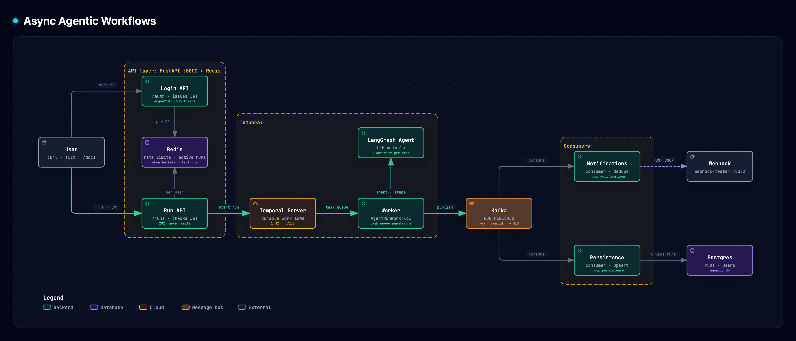

# Async Agentic Workflows

Run LangGraph agents as durable, asynchronous Temporal workflows.

1. You log in through the login API and get a JWT.
2. `POST /runs` checks the token, Redis rate limits and a per-user cap on active runs, then starts a Temporal workflow and returns right away.
3. The workflow runs the agent, with each LLM call and each tool call as its own Temporal activity.
4. When the run finishes, it publishes a `RUN_FINISHED` event to Kafka.
5. Two consumers react to the event: one records the run in Postgres, one sends a webhook notification.



- **Interactive version:** [`docs/architecture/architecture.html`](docs/architecture/architecture.html). Open it in a browser for hover details, path tracing and the cards.
- **Source:** `docs/architecture/architecture.json`. After changing it, re-render with archify and re-export the PNG from the viewer (**Export → PNG**).

## Phases

| # | Phase | Status |
|---|-------|--------|
| 1 | [LangGraph agent with tools](docs/phases/phase-1-langgraph-agent.md) (web_search, deep_analysis) | ✅ done |
| 2 | [Infrastructure in Docker Compose](docs/phases/phase-2-infrastructure.md) | ✅ done |
| 3 | [Temporal workflow + agent run API](docs/phases/phase-3-temporal.md) (+ Tilt dev loop; later, one activity per agent step) | ✅ done |
| 4 | [Kafka producer and consumers](docs/phases/phase-4-kafka.md) | ✅ done |
| 5 | [Login API](docs/phases/phase-5-login-api.md) | ✅ done |
| 6 | [Redis token-bucket rate limiting](docs/phases/phase-6-rate-limiting.md) (+ per-user active-run cap) | ✅ done |

## Quick start

Requires Python 3.13, [uv](https://docs.astral.sh/uv/) and Docker. Optional: [Tilt](https://tilt.dev) (`brew install tilt`) and `jq`, which the curl examples use.

```bash
cp .env.example .env        # fill in OPENAI_API_KEY (+ OPENAI_BASE_URL for a gateway) and JWT_SECRET (openssl rand -hex 32)
uv sync
```

**With Tilt** (recommended; `brew install tilt`): one command runs the infra, worker, API and both consumers, with a dashboard at http://localhost:10350:

```bash
tilt up                     # or: make dev
```

**Without Tilt:**

```bash
make up && make smoke       # Postgres, Temporal (+UI :8233), Kafka (+UI :8081), Redis, webhook inbox (:8082), Postgres UI (:8083)
make worker                 # terminal 1
make api                    # terminal 2: :8000
make consumer-persistence   # terminal 3: RUN_FINISHED → Postgres `runs`
make consumer-notifications # terminal 4: RUN_FINISHED → notification
```

`make` on its own lists every target, including `make test`, `make test-run PROMPT="..."`, `make psql`, `make redis-cli` and `make logs SVC=<service>`.

Register, log in, then start and poll a run. Or use the **Authorize** button at http://127.0.0.1:8000/docs, or Tilt's `send-test-run` button.

```bash
curl -XPOST localhost:8000/auth/register -H 'content-type: application/json' -d '{"email":"me@example.com","password":"a-long-password"}'
TOKEN=$(curl -s -XPOST localhost:8000/auth/login -d 'username=me@example.com&password=a-long-password' | jq -r .access_token)
curl -XPOST localhost:8000/runs -H "Authorization: Bearer $TOKEN" -H 'content-type: application/json' -d '{"prompt":"What is new in the latest Python release?"}'
curl localhost:8000/runs/<run_id> -H "Authorization: Bearer $TOKEN"
```

Login and register are rate-limited per IP, and the run routes per user. Each user can also have at most `MAX_ACTIVE_RUNS_PER_USER` runs in flight (default 3). Over a limit you get `429`, with `Retry-After` for the rate limits. See [Phase 6](docs/phases/phase-6-rate-limiting.md) for the limits and how to change them.

Local UIs (all on `127.0.0.1`, also linked from the Tilt dashboard):

| UI | URL | For |
| --- | --- | --- |
| API docs | http://127.0.0.1:8000/docs | try the API, with **Authorize** for the JWT |
| Temporal UI | http://127.0.0.1:8233 | runs as workflows: history, each activity, retries |
| Kafka UI | http://127.0.0.1:8081 | `RUN_FINISHED` and DLQ messages, consumer lag |
| Postgres UI (pgweb) | http://127.0.0.1:8083 | browse `users`, `runs`, `notifications_sent`; run SQL |
| Webhook inbox | http://127.0.0.1:8082/s/a9e7c0de-0000-4000-8000-000000000001 | notifications the consumer sent |
| Tilt dashboard | http://localhost:10350 | status and logs for every process |
| Streamlit test chat | http://127.0.0.1:8501 | the agent without Temporal; start it from Tilt or with the command below |

The host ports are deliberately non-default (Postgres `5433`, Redis `6380`) so they don't clash with local installs. Override them in `.env`.

Other entry points:

```bash
uv run agent "<prompt>"     # agent directly, no Temporal
uv run pytest               # all tests; the Kafka/Postgres/Redis ones skip unless the stack is up (make up)
```

For a manual test chat UI (testing only, not part of the product):

```bash
uv sync --group ui
uv run streamlit run ui/app.py
```

## See what a run did

After `POST /runs` returns a `run_id`:

- **Status and answer:** `GET /runs/<run_id>` with your token. `GET /runs` lists your finished runs.
- **Every agent step:** in the Temporal UI, open the workflow whose ID is the `run_id`. The History shows `agent.model` and `agent.tools` rows with their inputs and outputs, for example the search query and its results.
- **The event and its effects:** the webhook inbox shows the `RUN_FINISHED` JSON, and pgweb shows the row in `runs`.
- **Logs:** search Tilt's logs for the `run_id` to follow it through the API, the worker's steps, the publish and both consumers.

## Logging

Every process (API, worker, consumers, CLI) uses the same setup (`agentic_workflows/logs.py`): one line format on stderr, tagged with the service, and `LOG_LEVEL` from `.env` (default `INFO`; `DEBUG` also shows library logs such as httpx and aiokafka).

```
2026-10-11 20:27:01 INFO  [worker] agentic_workflows.agent.tools: [run_id=447aa14f-… agent.tools attempt=1] web_search query='structured logging' results=5 in 5.7s
```

- **Follow one run everywhere** with `run_id`. API, workflow, every agent step (with its attempt number), the Kafka publish and both consumers include it. In Tilt, search the logs for the run ID.
- **Secrets are never logged:** passwords, tokens, API keys, and the email from failed logins. Prompts and answers are logged by size only (`prompt_chars`, `answer_chars`).
- **Noise is filtered:** chatty libraries are held at WARNING, and the API's access log skips `/healthz` (Tilt's readiness probe).

## Layout

```
src/agentic_workflows/
  config.py          settings loaded from env / .env
  logs.py            shared logging setup + run-tagged step logger
  agent/
    graph.py         LangGraph StateGraph: model ⇄ tools loop
    tools.py         web_search (DuckDuckGo, no API key), deep_analysis (slow 5-7 min test tool)
    cli.py           `uv run agent "<prompt>"`
  workflows/         Temporal: AgentRunWorkflow (one activity per agent step), worker,
                     models.py (RunInput, RunResult, RunFinished event)
  api/               FastAPI app: main.py (lifespan, wiring), deps.py, schemas.py
    routes/          auth.py (/auth: register, login → JWT), runs.py (/runs, per-user)
    limits/          Redis rate limits + active-run cap, each with its Lua script
  events/producer.py RUN_FINISHED producer (Temporal activity)
  consumers/         persistence + notification consumers, retry/DLQ runner
  db.py              asyncpg pool + schema (users, runs, notifications_sent)
ui/app.py            Streamlit playground for manual testing
tests/               unit, Temporal time-skipping, and compose-backed integration tests (no LLM calls)
docs/phases/         one design doc per phase
CLAUDE.md            guidance for Claude Code: commands + cross-file invariants
docker-compose.yml   backing services (phase 2)
infra/               Postgres app-db init; Temporal server config, schema + namespace scripts
scripts/             smoke.py (`make smoke`), send_test_run.py (Tilt's send-test-run)
docs/architecture/   architecture diagram: .json source, .html render, .png for this README
Tiltfile             dev loop: infra, api, worker, both consumers, streamlit + buttons
```
