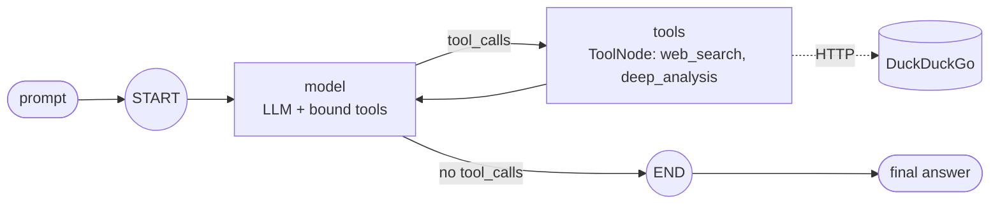

# Phase 1: LangGraph agent with tools

**Goal:** a working tool-calling agent that later phases run on Temporal.

> Since Phase 3's follow-up, each graph node runs as its own Temporal activity (see the [Phase 3 doc](phase-3-temporal.md)). That's why the nodes below are module-level `async` functions with activity metadata, and why routing uses an async `route` function instead of `tools_condition`.



## What's built

- `agent/graph.py`: a `StateGraph(MessagesState)` with two nodes:
  - `model`: calls the LLM with the tools bound.
  - `tools`: a `ToolNode` that runs any tool calls the model made.
  - An async `route` function sends `model → tools` while the model is still requesting tools, and to `END` once it isn't. `tools` always routes back to `model`.
- `agent/tools.py`: a `web_search` tool. It searches DuckDuckGo through the `ddgs` package, so no API key is needed, and returns the top 5 results as title, link and snippet. Errors come back as text so the model can retry or answer without them, instead of the run crashing.
- `agent/tools.py` also has `deep_analysis(topic)`, an async testing aid that sleeps 5–7 minutes to simulate a slow tool. The system prompt tells the model to use it only when the user explicitly asks for a deep analysis.
- `run_agent(prompt, llm=None, max_steps=10) -> str` runs the graph directly, for the CLI and tests. `AGENT_MAX_STEPS` caps the loop through LangGraph's `recursion_limit` (`max_steps * 2 + 1`). Under Temporal the workflow runs the same graph itself; see Phase 3.
- `config.py`: `pydantic-settings` reads `OPENAI_API_KEY`, `OPENAI_BASE_URL` and `LLM_MODEL`. Any OpenAI-compatible endpoint works.

## Run

```bash
uv run agent "What is new in the latest Python release?"
uv run pytest tests/test_agent.py   # this phase's tests: scripted fake chat model, no network
```

## Done when

- [x] The agent calls the tool and returns a final answer against a real LLM
- [x] Unit tests cover the tool and the model → tool → model loop
