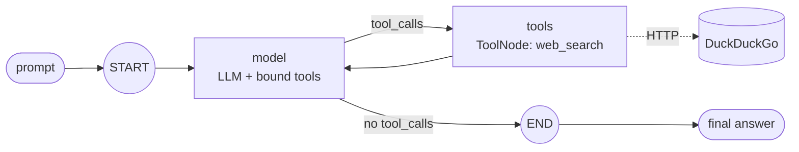

# Phase 1: Simple LangGraph agent with one tool

**Goal:** a working tool-calling agent that later phases wrap in a Temporal activity.



## What's built

- `agent/graph.py`: a `StateGraph(MessagesState)` with two nodes:
  - `model`: calls the LLM with the tools bound.
  - `tools`: a `ToolNode` that runs any tool calls the model made.
  - `tools_condition` routes `model → tools` while the model is still requesting tools, and to `END` once it isn't. `tools` always routes back to `model`.
- `agent/tools.py`: a `web_search` tool. It searches DuckDuckGo through the `ddgs` package, so no API key is needed, and returns the top 5 results as title, link and snippet. Errors come back as text so the model can retry or answer without them, instead of the run crashing.
- `run_agent(prompt) -> str`: an async entry point. Phase 3's Temporal activity will call it unchanged. `AGENT_MAX_STEPS` caps the loop through LangGraph's `recursion_limit`.
- `config.py`: `pydantic-settings` reads `OPENAI_API_KEY`, `OPENAI_BASE_URL` and `LLM_MODEL`. Any OpenAI-compatible endpoint works.

## Run

```bash
uv run agent "What is new in the latest Python release?"
uv run pytest            # uses a scripted fake chat model, no network
```

## Done when

- [x] The agent calls the tool and returns a final answer against a real LLM
- [x] Unit tests cover the tool and the model → tool → model loop
