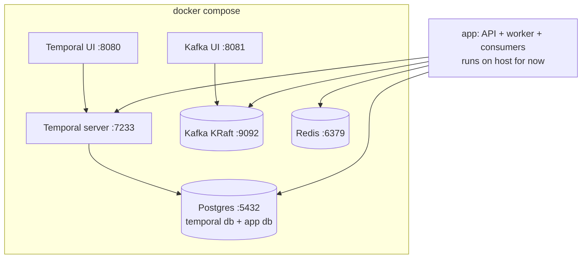

# Phase 2: Infrastructure in Docker Compose

**Goal:** `docker compose up` starts every backing service the later phases need, with health checks.

## Services

| Service | Image | Port | Used in |
|---|---|---|---|
| Postgres | `postgres` | 5432 | Temporal persistence, run records (phase 4), users (phase 5) |
| Temporal server | `temporalio/auto-setup` | 7233 | Phase 3 |
| Temporal UI | `temporalio/ui` | 8080 | Phase 3 |
| Kafka (KRaft, no ZooKeeper) | `apache/kafka` | 9092 | Phase 4 |
| Kafka UI (optional) | `provectuslabs/kafka-ui` | 8081 | Phase 4 |
| Redis | `redis` | 6379 | Phase 6 |

## Tasks

- [ ] `docker-compose.yml` with named volumes and a health check on every service
- [ ] A separate database in Postgres for the app versus Temporal (init script)
- [ ] Add all connection URLs to `.env.example`
- [ ] `make up` / `make down` / `make logs` helpers
- [ ] Smoke check: script that pings each service

## Done when

`docker compose up -d && docker compose ps` shows every service as healthy.
