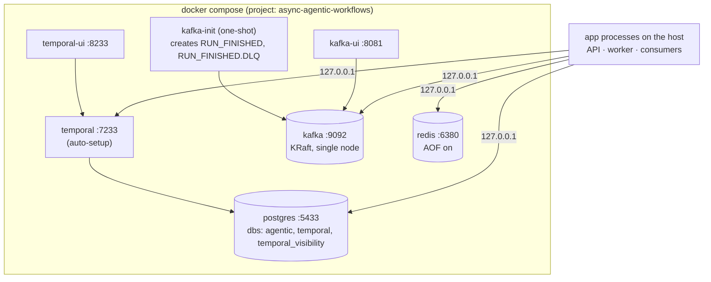

# Phase 2: Infrastructure in Docker Compose

**Goal:** `make up` starts every backing service the later phases need, and waits until all of them are healthy.



## Services

| Service | Image | Host port | Used in |
| --- | --- | --- | --- |
| `postgres` | `postgres:17-alpine` | 5433 | Temporal persistence; `agentic` db for run records (phase 4) and users (phase 5) |
| `temporal` | `temporalio/auto-setup:1.29.7` | 7233 | Phase 3 |
| `temporal-ui` | `temporalio/ui:2.55.0` | [8233](http://127.0.0.1:8233) | Phase 3 |
| `kafka` | `apache/kafka:4.2.2` | 9092 | Phase 4 |
| `kafka-init` | `apache/kafka:4.2.2` | — | creates topics, then exits |
| `kafka-ui` | `kafbat/kafka-ui:v1.5.0` | [8081](http://127.0.0.1:8081) | Phase 4 |
| `redis` | `redis:8.8-alpine` | 6380 | Phase 6 |

All ports bind to `127.0.0.1` only. You can override each host port in `.env` (see `.env.example`). The defaults avoid ports that are often already taken locally (5432, 6379, 8080).

## Design notes

- **Temporal on Postgres via `auto-setup`.** On first boot, the image creates the `temporal` and `temporal_visibility` databases and registers the `default` namespace. Temporal's own [docker-compose repo](https://github.com/temporalio/docker-compose) still uses this image. It's deprecated for production, which is fine for a local stack.
- **App database:** `infra/postgres/init/01-app-db.sh` creates `agentic`. It runs only against an empty volume, so after changing it run `make reset`.
- **Kafka has two listeners:**
  - `INTERNAL://kafka:29092` for other containers
  - `EXTERNAL://127.0.0.1:9092` for apps on the host

  The external address is advertised as `127.0.0.1` rather than `localhost`. Otherwise clients try `::1` first and log connection errors.
- **Topics are created explicitly** (`KAFKA_AUTO_CREATE_TOPICS_ENABLE=false`), 3 partitions each. A typo in a topic name fails loudly instead of quietly creating a new topic.
- **Health checks:**
  - Temporal: `temporal operator cluster health`
  - Kafka: `kafka-broker-api-versions.sh`
  - Postgres: `pg_isready`
  - Redis: `redis-cli ping`

  `make up` (`docker compose up -d --wait`) returns only when all of them pass.

## Commands

```bash
make up      # start and wait for healthy
make smoke   # check every service from the host
make ps      # status
make logs    # follow logs
make down    # stop, keep data
make reset   # stop and delete volumes
```

## Done when

- [x] `docker-compose.yml` with named volumes and a health check on every long-running service
- [x] Separate app database from Temporal's (init script)
- [x] All connection URLs in `.env.example`
- [x] `make up` / `down` / `reset` / `logs` / `smoke`
- [x] `make smoke` passes; a real Kafka client on the host sees both topics
