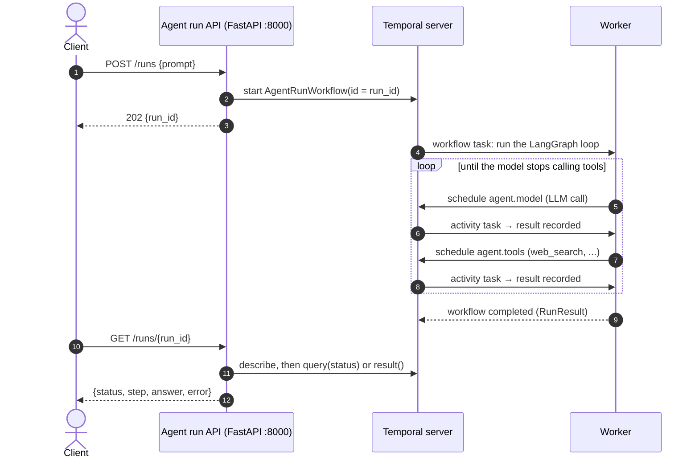
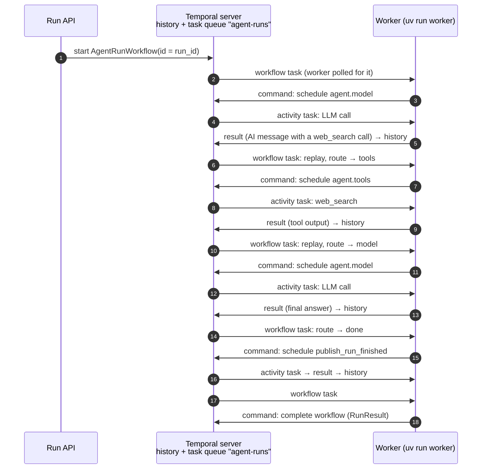
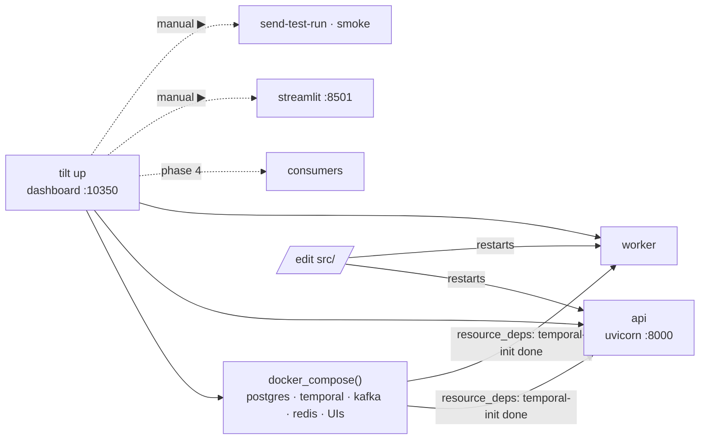

# Phase 3: Temporal workflow and agent run API

**Goal:** agent runs become durable, async Temporal workflows started from an HTTP API.



## What's built

```
src/agentic_workflows/
  workflows/
    models.py       RunInput, RunResult, RunFinished (dataclasses)
    agent_run.py    AgentRunWorkflow: runs the LangGraph loop + `status` query
    worker.py       `uv run worker` on task queue `agent-runs`, with the LangGraph plugin
  agent/graph.py    the graph; its `model` and `tools` nodes are the activities
  api/
    main.py         `app`, lifespan (connects the Temporal client), /healthz
    routes/runs.py  APIRouter: POST /runs, GET /runs/{id}
    schemas.py      request/response models
    deps.py         get_temporal_client, get_task_queue
Tiltfile            dev loop (below)
```

### Workflow and activities: one activity per agent step

The agent loop runs **inside the workflow**, and each LangGraph node execution is its own activity, using Temporal's [LangGraph plugin](https://github.com/temporalio/sdk-python/tree/main/temporalio/contrib/langgraph) (`temporalio.contrib.langgraph`, experimental):

| Activity | What it does | Timeout · retries |
| --- | --- | --- |
| `agent.model` | One LLM call with the conversation so far | 2 min · 3 attempts |
| `agent.tools` | Runs the tool calls from the last LLM reply (`web_search`, `deep_analysis`) | 10 min (deep_analysis takes up to 7) · 3 attempts |
| `publish_run_finished` | Phase 4: the `RUN_FINISHED` event | 30 s · until Kafka accepts |

What that buys:
- **Every step is visible in the Temporal UI:**
  - each LLM call and each tool call is its own row in the run's history
  - its **input** is the messages so far, and its **result** is the LLM's reply with any tool calls, or the tool output
  - each row has a readable summary, e.g. `LLM call · 3 messages in context` or `web_search('kafka consumer groups')`
- **Retries are per step.** A flaky LLM call is retried on its own; the tool calls before it aren't re-run.
- **A crash resumes from the last finished step,** not from the start of the agent (see "How Temporal works here" below).

How it's wired:
- **Worker:** registers the graph with `LangGraphPlugin(graphs={"agent": build_state_graph()})`. The plugin turns each node marked `execute_in: "activity"` into an activity named `agent.<node>`, with the timeouts and retries set in the node's metadata (`agent/graph.py`).
- **Workflow:** calls `graph("agent").compile().ainvoke(...)`. The routing between nodes, deciding "more tools or done?", runs in workflow code, so the router is an `async` function: a sync router would use a thread, which the workflow sandbox forbids.
- **Data converter:** the worker **and** the API client use `pydantic_data_converter`, because LangChain messages are pydantic models. Inside an activity they arrive as dicts, and each node calls `convert_to_messages` before using them.
- **Step cap:** `RunInput.max_steps` (from `AGENT_MAX_STEPS`) is part of the workflow input, so a replay always sees the same limit. Hitting it fails the run with `agent exceeded N steps`.
- **Same graph outside Temporal:** the CLI and Streamlit run the same graph directly (`build_graph()`), all in one process.
- **No activity heartbeats, on purpose.** If a worker dies mid-step, Temporal notices once that step's `start_to_close_timeout` runs out (2 minutes for a model call, 10 for tools), then retries it on another worker.
- **Worker heartbeats are a different thing:** the worker tells the server it's alive, for the UI's Workers page. They're turned on with `frontend.workerHeartbeatsEnabled` in `infra/temporal/dynamicconfig.yaml`, and they need server 1.30 or later for `ListWorkers`, which is why Phase 3 moved the stack to Temporal 1.32 (see the Phase 2 doc).
- **Progress:** the `status` query reports `queued` → `running_agent` → `publishing` → `completed` or `failed`. `publishing` was added in Phase 4.
- **Deploying this change:** this replaced the earlier single `run_agent_activity`. Runs started on that code can't replay on this one, so drain or finish them before deploying. Future changes to the workflow's shape should use `workflow.patched()`.

### API

> Since Phase 5, every `/runs` route needs a Bearer token and only shows the caller's own runs. See [Phase 5](phase-5-login-api.md).

| Method   | Path                                   | Returns                                                                  |
| -------- | -------------------------------------- | ------------------------------------------------------------------------ |
| `POST` | `/runs` `{prompt}` (1–4000 chars) | `202 {run_id}` right away; the workflow ID is the `run_id`           |
| `GET`  | `/runs/{run_id}`                     | `{run_id, status, step, answer, error}`; `404` if the run is unknown |
| `GET`  | `/healthz`                           | `{ok: true}`                                                           |

- `status` is Temporal's execution status, lowercased (`running`, `completed`, `failed`, `terminated`, ...).
- `step` comes from the workflow query while the run is going. Queries need a live worker. If none is polling, `step` is `null` and the call still returns 200. The query is capped at 2 seconds so a status read never hangs.
- **No app factory.** `app` is defined at module level. Routes get the Temporal client and the task queue through `Depends(...)`, and the tests replace both with `app.dependency_overrides`, pointing them at Temporal's test server. httpx's ASGI transport doesn't run lifespan, so the tests never connect to a real Temporal.

## How Temporal works here

A common first picture is "the workflow puts activities on a queue and a worker polls it". Workers do poll, but two pieces are missing from that picture, and they're what make runs durable:

1. **The Temporal server owns the task queue and an event history for every run.** The history is stored in Postgres (`temporal` db). The server never pushes work. Workers long-poll it.
2. **The workflow code runs on a worker too.** When `AgentRunWorkflow` reaches `execute_activity(...)`, it doesn't call the activity. It sends the server a *command*, "schedule this activity". The server records it in the history and puts an **activity task** on the queue.

So the task queue `agent-runs` carries two kinds of task:

| Task                    | What the worker does with it                                                                                                        |
| ----------------------- | ----------------------------------------------------------------------------------------------------------------------------------- |
| **Workflow task** | Runs (or replays)`AgentRunWorkflow` code up to the next `await`, then sends back commands: schedule an activity, complete, fail |
| **Activity task** | Runs one activity (`agent.model`, `agent.tools` or `publish_run_finished`), then reports the result or the error |

There's no direct hop from one activity to the next. Every step goes through the server:



**Why this survives crashes:**

- **Crash between activities:** if the worker dies, another worker (or the same one after a restart) picks up the next workflow task. It **replays** the workflow code against the recorded history, skipping every step that already has a result, and carries on from where the run was.
- **Crash during an activity:** only that one step is lost, say a single LLM call or a single search. It's retried per its `RetryPolicy` once its timeout fires. Every earlier step's result is already in the history and is never re-run.

This is also the reason for the main rule of workflow code: **it must be deterministic.** Replaying the same history must produce the same commands. That's why every LLM call, every tool call and the Kafka publish are activities, and the workflow takes its timestamps from `workflow.now()` instead of `datetime.now()`.

**In this project:**

- **One task queue, one worker process for everything:** `agent-runs`, and the worker in `workflows/worker.py`. It registers the workflow, the publish activity, and the plugin's two node activities:

  ```python
  Worker(client, task_queue="agent-runs",
         workflows=[AgentRunWorkflow],
         activities=[events.publish_run_finished],
         plugins=[LangGraphPlugin(graphs={"agent": build_state_graph()})])  # agent.model, agent.tools
  ```
- **Splitting later is possible.** Activities could go on their own task queue with separate workers, for example to scale the agent independently of the workflow code, but there's no need yet.
- **Running more workers is the scaling knob.** Any worker polling `agent-runs` can take any task, so you add workers by starting more `uv run worker` processes.

## Running it

```bash
make up                     # infra from phase 2
uv run worker               # terminal 1
uv run uvicorn agentic_workflows.api.main:app --port 8000   # terminal 2

# since Phase 5 you need a token first; see the Phase 5 doc's "Try it"
curl -XPOST localhost:8000/runs -H "Authorization: Bearer $TOKEN" -H 'content-type: application/json' -d '{"prompt":"..."}'
curl localhost:8000/runs/<run_id> -H "Authorization: Bearer $TOKEN"
```

Or start everything with Tilt (next section).

## Local dev loop: Tilt

From this phase on there are several processes running on the host next to the compose stack. [Tilt](https://tilt.dev) runs all of them from one `tilt up`, with one dashboard at http://localhost:10350.



| Resource            | Label     | What it does                                                                                                                                                                                                                                             |
| ------------------- | --------- | -------------------------------------------------------------------------------------------------------------------------------------------------------------------------------------------------------------------------------------------------------- |
| `temporal-schema`, `temporal`, `temporal-init`, `temporal-ui` | `temporal` | the Temporal server, its two one-shots (schema setup, namespace registration) and the UI, linked from the dashboard. |
| `kafka`, `kafka-init`, `kafka-ui` | `kafka` | the broker, the topic-creating one-shot, and the Kafka UI. |
| `postgres`, `redis`, `pgweb` | `data` | the app and Temporal databases, the rate-limit store, and the Postgres UI. |
| `webhook-tester` | `tools` | the dummy notification receiver; its inbox is linked from the dashboard. |
| `worker`, `api` | `app`   | `serve_cmd` processes. Tilt restarts them when anything under `src/` changes and starts them only after `temporal-init` has finished, meaning the server is serving and the namespace exists. `api` has an HTTP readiness probe on `/healthz`. |
| `consumer-persistence`, `consumer-notifications` | `app` | Phase 4's `RUN_FINISHED` consumers. They restart on `src/` changes and start after `kafka-init` and `postgres`. |
| `streamlit`       | `tools` | the testing-only chat UI. Starts only when you click ▶.                                                                                                                                                                                                 |
| `send-test-run`   | `tools` | button:`POST /runs` with a sample prompt. The run ID shows in its log.                                                                                                                                                                                 |
| `smoke`           | `tools` | button:`make smoke`                                                                                                                                                                                                                                    |

```bash
brew install tilt
tilt up          # Ctrl-C leaves the stack running; `tilt down` stops it (volumes are kept)
```

- **Tilt is optional.** `make up` plus the two commands above work without it.
- **Pinned project name.** The Tiltfile sets `project_name="async-agentic-workflows"`. Tilt ignores the compose file's `name:` and would otherwise start a second stack, named after the directory, that clashes on ports with one started by `make up`.
- **Restarts come from Tilt.** It watches `deps=["src"]` and restarts the processes, so `uvicorn --reload` isn't used. One mechanism for every process.
- **Why Tilt and not a Procfile (`honcho` / `overmind`):** Tilt adds a web UI with status and logs for each process, restarts on file change, and dependency ordering between containers and processes. A Procfile would only interleave the logs.

## Done when

- [X] `POST /runs` returns immediately and the run shows up in the Temporal UI
- [X] Killing the worker (`kill -9`) mid-run and restarting it: the run completes, and **only the interrupted step re-runs**. Verified live: the worker was killed during the final LLM call; after that step's 2-minute timeout it ran again as `attempt 2`, while the first LLM call and the search, already in the history, ran once each.
- [X] Integration tests on Temporal's time-skipping test server cover:
  - the happy path
  - retry, then succeed
  - failure after the maximum number of attempts
  - the API end to end
  - the API when no worker is polling
- [X] `tilt up` brings up infra, worker and API. Editing `src/` restarts the worker. `make up` still works without Tilt.
