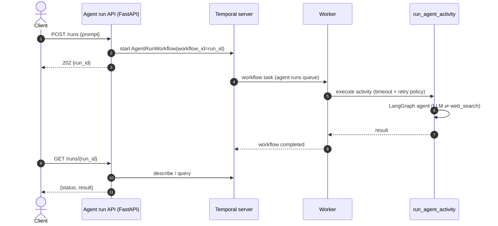
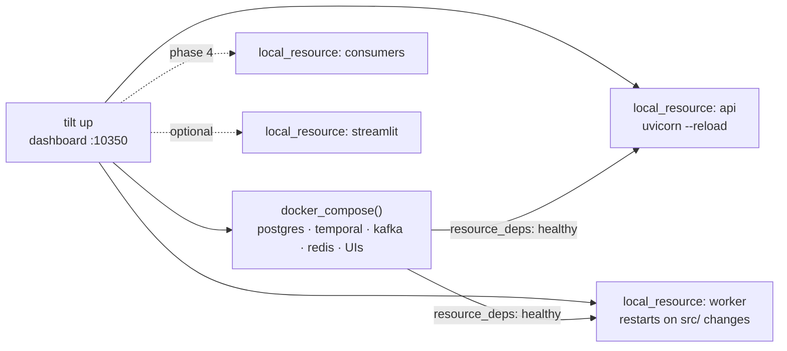

# Phase 3: Temporal workflow and agent run API

**Goal:** agent runs become durable, async Temporal workflows started from an HTTP API.

## Design

- **Activity** `run_agent_activity(prompt) -> str` wraps Phase 1's `run_agent`. LLM calls aren't deterministic, so they must live in an activity, never in workflow code.
  - `start_to_close_timeout` plus a `RetryPolicy` for LLM and network failures
  - heartbeats for long runs
- **Workflow** `AgentRunWorkflow(run_id, prompt)`: runs the activity and returns the result. A query handler exposes the current status.
- **Worker** process (`uv run worker`) on the `agent-runs` task queue.
- **Agent run API** (FastAPI):
  - `POST /runs {prompt}` → starts the workflow with `workflow_id = run_id` and returns `202 {run_id}` right away
  - `GET /runs/{run_id}` → status and result, read via a workflow describe/query

## Local dev loop: Tilt

From this phase on there are several processes running on the host next to the compose stack: the API, the worker, and later the Kafka consumers and the Streamlit UI. [Tilt](https://tilt.dev) runs all of them from one `tilt up`, with one dashboard at http://localhost:10350.

**Tiltfile** (about 30 lines, Starlark):

- `docker_compose("docker-compose.yml")` brings the Phase 2 stack in as Tilt resources, grouped with `labels=["infra"]`.
- `local_resource("worker", serve_cmd="uv run worker", deps=["src/"], resource_deps=["temporal"])` restarts the worker when code changes and starts it only after Temporal is healthy.
- `local_resource("api", serve_cmd="uv run uvicorn ... --reload", resource_deps=["temporal"], links=[...])` adds links to `/docs` and the Temporal UI.
- Buttons for common actions, using the `uibutton` extension or manual `local_resource` triggers:
  - send a test run (`POST /runs`)
  - `make reset`
- `streamlit` is `auto_init=False`, so it starts only when you click it.

**Keep it optional:** `make up` plus starting the processes by hand must keep working, so you don't need Tilt to run the project. Install it with `brew install tilt`.

**Why Tilt and not a Procfile (`honcho` / `overmind`):** Tilt adds a web UI with status and logs for each process, restarts on file change, and dependency ordering between containers and processes. A Procfile would only interleave the logs.

## Done when

- [ ] `POST /runs` returns immediately and the run shows up in the Temporal UI
- [ ] Killing the worker mid-run and restarting it resumes the run
- [ ] Integration test using Temporal's time-skipping test environment
- [ ] `tilt up` brings up infra, worker and API. Editing `src/` restarts the worker. `make up` still works without Tilt.
