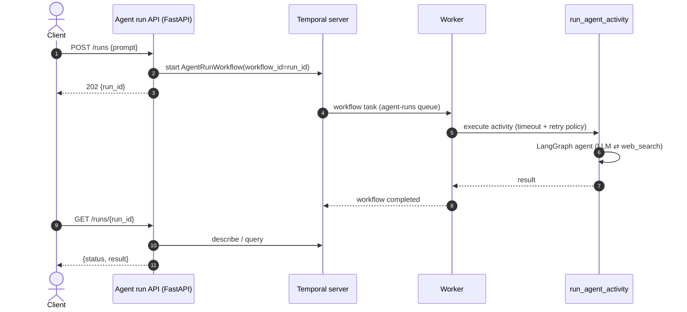

# Phase 3: Temporal workflow and agent run API

**Goal:** agent runs become durable, async Temporal workflows started from an HTTP API.

## Design

- **Activity** `run_agent_activity(prompt) -> str` wraps Phase 1's `run_agent`. LLM calls aren't deterministic, so they must live in an activity, never in workflow code.
  - `start_to_close_timeout` plus a `RetryPolicy` for LLM and network failures
  - heartbeats for long runs
- **Workflow** `AgentRunWorkflow(run_id, prompt)`: runs the activity and returns the result. A query handler exposes the current status.
- **Worker** process (`uv run worker`) on the `agent-runs` task queue.
- **Agent run API** (FastAPI):
  - `POST /runs {prompt}` → starts the workflow with `workflow_id = run_id` and returns `202 {run_id}` right away
  - `GET /runs/{run_id}` → status and result, read via a workflow describe/query

## Done when

- [ ] `POST /runs` returns immediately and the run shows up in the Temporal UI
- [ ] Killing the worker mid-run and restarting it resumes the run
- [ ] Integration test using Temporal's time-skipping test environment
