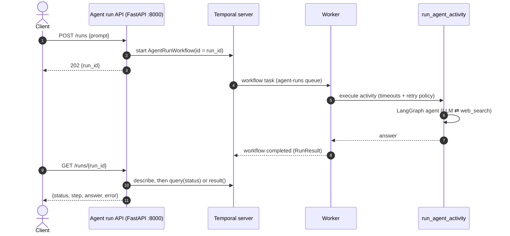
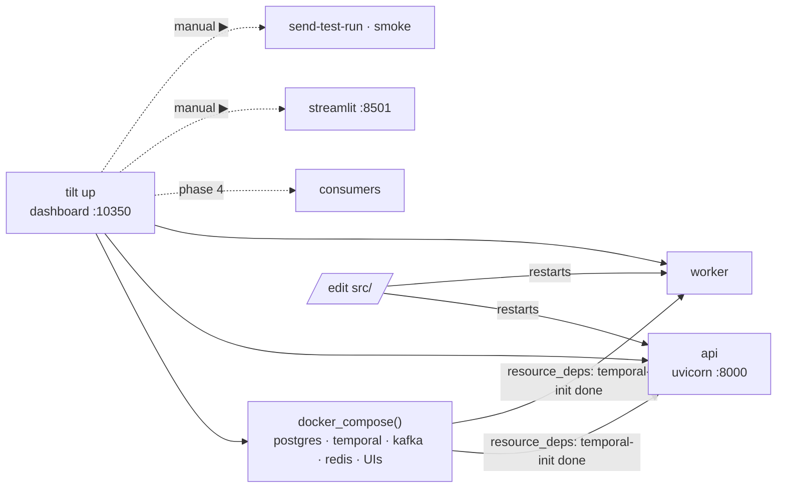

# Phase 3: Temporal workflow and agent run API

**Goal:** agent runs become durable, async Temporal workflows started from an HTTP API.



## What's built

```
src/agentic_workflows/
  workflows/
    models.py       RunInput, AgentInput, RunResult (dataclasses)
    activities.py   run_agent_activity: calls the Phase 1 agent
    agent_run.py    AgentRunWorkflow + `status` query
    worker.py       `uv run worker` on task queue `agent-runs`
  api/
    main.py         `app`, lifespan (connects the Temporal client), /healthz
    runs.py         APIRouter: POST /runs, GET /runs/{id}
    schemas.py      request/response models
    deps.py         get_temporal_client, get_task_queue
Tiltfile            dev loop (below)
```

### Workflow and activity

- **The LLM work stays out of workflow code.** `AgentRunWorkflow` only orchestrates. Workflow code has to be deterministic so Temporal can replay it, so the LLM and web calls live in `run_agent_activity`. Activity imports go through `workflow.unsafe.imports_passed_through()` so the sandbox doesn't reload LangChain on every replay.
- **Activity options:**
  - `start_to_close_timeout=5m` caps a single attempt.
  - **No activity heartbeats, on purpose.** If a worker dies mid-run, Temporal only notices once the 5-minute `start_to_close_timeout` runs out, and then retries on another worker. If faster crash detection matters later, add `heartbeat_timeout` plus `activity.heartbeat()` calls.
  - **Worker heartbeats are a different thing:** the worker tells the server it's alive, for the UI's Workers page. They're turned on with `frontend.workerHeartbeatsEnabled` in `infra/temporal/dynamicconfig.yaml`. They need server 1.30 or later for `ListWorkers`, which is why Phase 3 moved the stack to Temporal 1.32 (see the Phase 2 doc).
  - `RetryPolicy(initial_interval=2s, backoff=2.0, maximum_attempts=3)`. After the third failure the workflow fails, and `GET /runs/{id}` returns `status: failed` with the error.
- **Progress:** the `status` query reports finer-grained progress (`queued` → `running_agent` → `publishing` → `completed` or `failed`). The `publishing` step was added in Phase 4.
- **What survives a crash:** workflow state does. The current activity attempt doesn't: when a worker dies mid-run, the agent restarts from scratch on the next attempt. That's fine for now. Making single agent steps resumable (for example, a LangGraph checkpointer per run) is a later optimization.

### API

> Since Phase 5, every `/runs` route needs a Bearer token and only shows the caller's own runs. See [Phase 5](phase-5-login-api.md).

| Method | Path | Returns |
| --- | --- | --- |
| `POST` | `/runs` `{prompt}` (1–4000 chars) | `202 {run_id}` right away; the workflow ID is the `run_id` |
| `GET` | `/runs/{run_id}` | `{run_id, status, step, answer, error}`; `404` if the run is unknown |
| `GET` | `/healthz` | `{ok: true}` |

- `status` is Temporal's execution status, lowercased (`running`, `completed`, `failed`, `terminated`, ...).
- `step` comes from the workflow query while the run is going. Queries need a live worker. If none is polling, `step` is `null` and the call still returns 200. The query is capped at 2 seconds so a status read never hangs.
- **No app factory.** `app` is defined at module level. Routes get the Temporal client and the task queue through `Depends(...)`, and the tests replace both with `app.dependency_overrides`, pointing them at Temporal's test server. httpx's ASGI transport doesn't run lifespan, so the tests never connect to a real Temporal.

## Running it

```bash
make up                     # infra from phase 2
uv run worker               # terminal 1
uv run uvicorn agentic_workflows.api.main:app --port 8000   # terminal 2

curl -XPOST localhost:8000/runs -H 'content-type: application/json' -d '{"prompt":"..."}'
curl localhost:8000/runs/<run_id>
```

Or start everything with Tilt (next section).

## Local dev loop: Tilt

From this phase on there are several processes running on the host next to the compose stack. [Tilt](https://tilt.dev) runs all of them from one `tilt up`, with one dashboard at http://localhost:10350.



| Resource | Label | What it does |
| --- | --- | --- |
| compose services | `infra` | the Phase 2 stack, including the `temporal-schema` and `temporal-init` one-shots. The UIs have links in the dashboard. |
| `worker`, `api` | `app` | `serve_cmd` processes. Tilt restarts them when anything under `src/` changes and starts them only after `temporal-init` has finished, meaning the server is serving and the namespace exists. `api` has an HTTP readiness probe on `/healthz`. |
| `streamlit` | `tools` | the testing-only chat UI. Starts only when you click ▶. |
| `send-test-run` | `tools` | button: `POST /runs` with a sample prompt. The run ID shows in its log. |
| `smoke` | `tools` | button: `make smoke` |

```bash
brew install tilt
tilt up          # Ctrl-C leaves the stack running; `tilt down` stops it (volumes are kept)
```

- **Tilt is optional.** `make up` plus the two commands above work without it.
- **Pinned project name.** The Tiltfile sets `project_name="async-agentic-workflows"`. Tilt ignores the compose file's `name:` and would otherwise start a second stack, named after the directory, that clashes on ports with one started by `make up`.
- **Restarts come from Tilt.** It watches `deps=["src"]` and restarts the processes, so `uvicorn --reload` isn't used. One mechanism for every process.
- **Why Tilt and not a Procfile (`honcho` / `overmind`):** Tilt adds a web UI with status and logs for each process, restarts on file change, and dependency ordering between containers and processes. A Procfile would only interleave the logs.

## Done when

- [x] `POST /runs` returns immediately and the run shows up in the Temporal UI
- [x] Killing the worker (`kill -9`) mid-run and restarting it: the run completes. Without activity heartbeats, the retry waits for the 5-minute attempt timeout.
- [x] Integration tests on Temporal's time-skipping test server cover:
  - the happy path
  - retry, then succeed
  - failure after the maximum number of attempts
  - the API end to end
  - the API when no worker is polling
- [x] `tilt up` brings up infra, worker and API. Editing `src/` restarts the worker. `make up` still works without Tilt.
