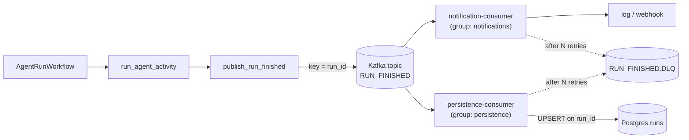

# Phase 4: Kafka producer and consumers

**Goal:** a finished run publishes `RUN_FINISHED`. Independent consumers react to it.

## Design

- **Producer:** after the agent activity, the workflow runs a `publish_run_finished` activity that sends to topic `RUN_FINISHED`. The key is `run_id`, so all events for a run stay ordered within one partition.
- **Event schema** (Pydantic, JSON): `run_id, user_id, status, result, error, started_at, finished_at`
- **Consumers**, each in its own consumer group so both get every event:
  - `notification-consumer`: sends the notification (log/webhook to start)
  - `persistence-consumer`: upserts a `runs` row in Postgres
- Delivery is at-least-once, so consumers must be idempotent: upsert on `run_id` and dedupe notifications.
- Failed messages go to a `RUN_FINISHED.DLQ` topic after N retries.

## Done when

- [ ] One run → one Postgres row and one notification, even after a consumer restart replays messages
- [ ] Integration test against the compose Kafka
