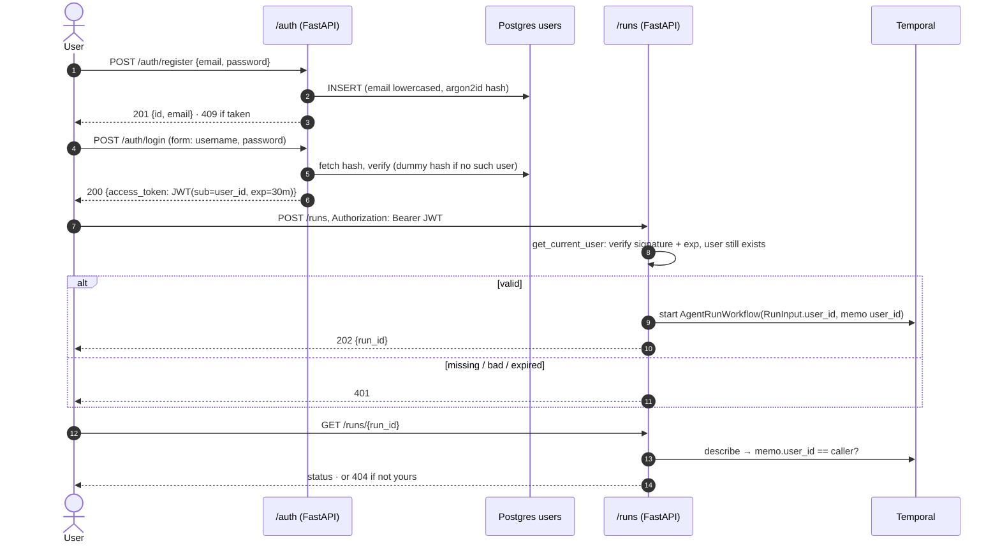

# Phase 5: Login API

**Goal:** only authenticated users can start or read runs, and each user only ever sees their own.



## What's built

```
src/agentic_workflows/api/
  auth.py      /auth/register, /auth/login, /auth/me; get_current_user (CurrentUser)
  runs.py      every route takes CurrentUser; GET /runs lists your finished runs
  schemas.py   + RegisterUser, User, Token, RunSummary
  deps.py      + get_db (asyncpg pool created in lifespan)
db.py          + users table, runs(user_id, finished_at) index
scripts/send_test_run.py   log in as a dev user and start a run (Tilt button)
```

### Endpoints

| Method | Path | Auth | Returns |
| --- | --- | --- | --- |
| `POST` | `/auth/register` `{email, password}` | — | `201 {id, email}`, `409` if the email is taken, `422` for a bad email or a password under 8 characters |
| `POST` | `/auth/login` (form: `username`=email, `password`) | — | `200 {access_token, token_type: "bearer", expires_in}`, or `401` |
| `GET` | `/auth/me` | Bearer | `{id, email}` |
| `POST` | `/runs` `{prompt}` | Bearer | `202 {run_id}` |
| `GET` | `/runs?limit=20` | Bearer | your finished runs from Postgres, newest first |
| `GET` | `/runs/{run_id}` | Bearer | status, step, answer, error. `404` if it's not yours. |

Any `/runs` route or `/auth/me` without a valid token returns `401` with `WWW-Authenticate: Bearer`.

### Design decisions

- **OAuth2 password flow** (`OAuth2PasswordRequestForm` plus `OAuth2PasswordBearer(tokenUrl="/auth/login")`). It's the FastAPI standard, so the **Authorize** button at http://127.0.0.1:8000/docs logs you in and attaches the token to every request.
- **Passwords:**
  - **Hashing:** argon2id via `pwdlib` (`PasswordHash.recommended()`). Only the hash is stored.
  - **Email:** lowercased on register and login, so `Alice@x.com` and `alice@x.com` are the same account.
  - **Same 401 for every login failure:** a wrong password and an unknown email return the same 401 body. An unknown email is still checked against a dummy hash, so it takes about as long as a real check, and response time doesn't reveal which emails are registered.
- **Tokens:**
  - **Format:** HS256 JWTs with claims `sub` (user id), `iat` and `exp` (`JWT_TTL_MINUTES`, default 30). Decoding requires both `sub` and `exp`.
  - **Every request re-checks the user exists,** so a deleted user's still-valid token stops working right away.
  - **The secret:** `JWT_SECRET` must be at least 32 characters (RFC 7518 §3.2). The API refuses to start otherwise. Only the API needs it; the worker and consumers don't.
  - **No refresh tokens or revocation list yet.** Log in again when the token expires.
- **Who owns a run is recorded in two places:**
  - **`RunInput.user_id`** goes through the workflow into `RUN_FINISHED.user_id`, which lands in the Postgres `runs` row and the webhook body.
  - **The workflow memo** (`memo={"user_id": ...}`) lets `GET /runs/{id}` check ownership with a single `describe()`, without reading the workflow's history.
  - **Someone else's run returns 404, not 403,** so run IDs can't be probed to find out which ones exist.
- **`GET /runs` reads Postgres,** not Temporal. It lists finished runs, since a row appears once the persistence consumer records `RUN_FINISHED`. In-flight runs are read by ID.
- **Schema:** the `users` table is created by the same idempotent bootstrap as the Phase 4 tables, now run by the API too, under the same advisory lock. All changes so far only add tables. Switch to a migration tool the first time an existing table has to be altered.
- **Workflow compatibility:** `RunInput.user_id` defaults to `None`, so the histories of runs started before this phase still decode. Those runs have no memo, so they come back as 404 to everyone. The new field doesn't change the workflow's command sequence, so it's replay-safe.

## Try it

```bash
# register + log in
curl -XPOST localhost:8000/auth/register -H 'content-type: application/json' \
  -d '{"email":"me@example.com","password":"a-long-password"}'
TOKEN=$(curl -s -XPOST localhost:8000/auth/login -d 'username=me@example.com&password=a-long-password' | jq -r .access_token)

# start a run, poll it, list your runs
curl -XPOST localhost:8000/runs -H "Authorization: Bearer $TOKEN" -H 'content-type: application/json' -d '{"prompt":"..."}'
curl localhost:8000/runs/<run_id> -H "Authorization: Bearer $TOKEN"
curl localhost:8000/runs -H "Authorization: Bearer $TOKEN"
```

There are two shortcuts:
- **Tilt's `send-test-run` button** runs `scripts/send_test_run.py`, which registers or logs in `dev@example.com` and starts a run.
- **`/docs` → Authorize** logs you in for every request on that page.

## Done when

- [x] `/runs` returns 401 without a valid token. Tests cover a missing, garbage, expired, forged (wrong secret) and deleted-user token.
- [x] A run row in Postgres is tied to the user who started it. Verified live: the `runs.user_id` and the webhook body's `user_id` both match the logged-in user.
- [x] Users only see their own runs:
  - `GET /runs/{id}` returns 404 to another user. That's tested, and was verified live.
  - `GET /runs` lists only the caller's rows. That's tested.
- [x] Tests:
  - register and login, with case-insensitive email
  - the stored hash is argon2id
  - a wrong password and an unknown email get identical 401s
  - input validation
  - the starting user is carried onto `RUN_FINISHED`
