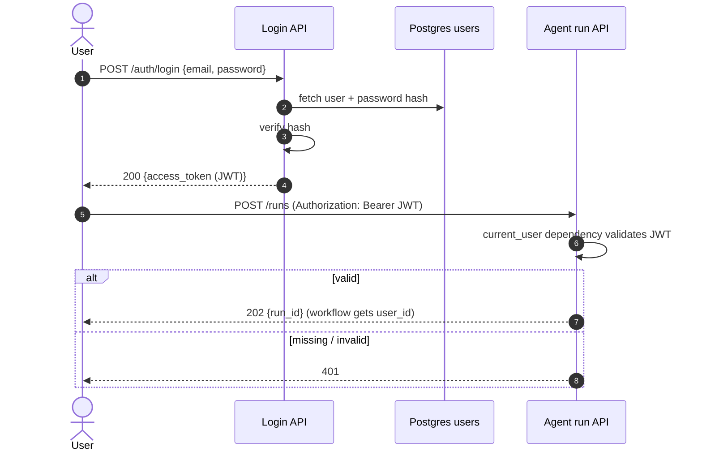

# Phase 5: Login API

**Goal:** only authenticated users can start or read runs.

## Design

- `users` table in Postgres (email, bcrypt/argon2 password hash)
- `POST /auth/register` and `POST /auth/login` → short-lived JWT access token
- FastAPI dependency `current_user` protects `/runs`. `user_id` is passed into the workflow and the `RUN_FINISHED` event.
- Users can read only their own runs.

## Done when

- [ ] `/runs` returns 401 without a valid token
- [ ] A run row in Postgres is tied to the user who started it
