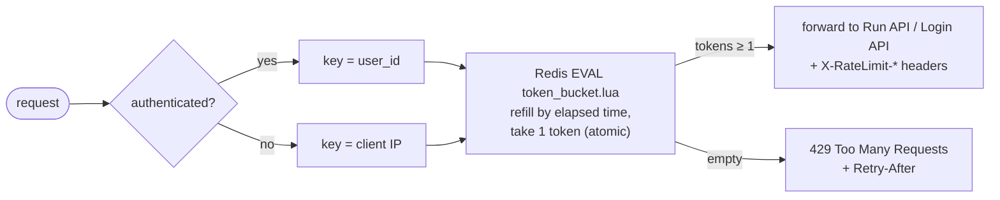

# Phase 6: Redis token-bucket rate limiting

**Goal:** cap how fast each user (or IP, before login) can hit the API, in front of both the run API and the login API.

## Design

- A token bucket per key (`user_id` if authenticated, else client IP), with `capacity` and `refill_rate` configurable per route
- An atomic Lua script in Redis: refill based on elapsed time, take one token, and return allowed/remaining/retry-after. One round trip, and it stays safe across many API replicas.
- Applied as FastAPI middleware or a dependency
- Over limit → `429` with `Retry-After` and `X-RateLimit-*` headers
- Login gets a stricter bucket to slow brute-force attempts

## Done when

- [ ] A burst above capacity gets 429s, and tokens refill at the configured rate
- [ ] Unit test of the Lua script against a real Redis
