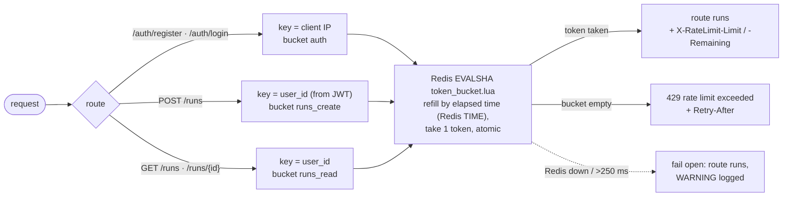

# Phase 6: Redis token-bucket rate limiting

**Goal:** cap how fast each client can hit the API: login and register per IP (against brute force), starting runs and reading runs per user (each run costs LLM calls). Also cap how many runs each user has in flight at once, since one run can take many minutes.



## Limits

| Bucket | Key | Default | Routes |
| --- | --- | --- | --- |
| `auth` | client IP | `5/min` | `POST /auth/register`, `POST /auth/login` |
| `runs_create` | user ID | `5/min` | `POST /runs` |
| `runs_read` | user ID | `60/min` | `GET /runs`, `GET /runs/{id}` |

The format is `"<burst>/<period>"`, with the period in `s`, `min` or `h`. `5/min` means a full bucket allows 5 requests at once, then refills one token every 12 seconds (5 per minute). Set them with `RATE_LIMIT_AUTH`, `RATE_LIMIT_RUNS_CREATE` and `RATE_LIMIT_RUNS_READ`, and turn everything off with `RATE_LIMIT_ENABLED=false`. That includes the active-run cap below, which also uses Redis.

On top of the rate, `POST /runs` is capped at **`MAX_ACTIVE_RUNS_PER_USER` runs in flight** (default `3`, `0` = no cap). A rate limit alone doesn't bound this: at `5/min`, a user whose runs each take 7 minutes could have 35 going at once. Over the cap you get `429 too many active runs (3/3); wait for one to finish`, with no `Retry-After`, because nobody knows when a run will end.

## How it works

```
src/agentic_workflows/api/
  limits/
    token_bucket.lua  the token-bucket script Redis runs (refill, take, return decision)
    ratelimit.py      loads the script; Limit.parse, RateLimiter.check / .enforce
    active_runs.lua   admits a run if the user's active-run set has room (atomic)
    active_runs.py    ActiveRunLimiter.enforce / .release; frees finished runs via Temporal
  routes/
    auth.py           limit_by_ip dependency on /auth/register and /auth/login
    runs.py           limit_by_user(bucket) dependency on every /runs route
  main.py             builds the Redis client, the RateLimiter, and the ActiveRunLimiter (only if MAX_ACTIVE_RUNS_PER_USER > 0)
  deps.py             get_limiter, get_active_runs (None = no limiting)
```

- **One Lua script, one round trip.** Each `(bucket, key)` is a Redis hash `{tokens, ts}`. The script:
  1. refills `tokens` for the time since `ts`, capped at the burst size
  2. takes one token if there is one
  3. saves the new state
  4. returns `allowed`, `remaining` and `retry_after`

  Redis runs scripts one at a time, so check-and-take can't race, even across many API replicas.
- **Redis's clock, not the API's.** The script reads `TIME` inside Redis, so replicas with drifting clocks can't hand out extra tokens.
- **Idle buckets clean themselves up.** Each key expires shortly after it would be full again (`capacity / rate`), so Redis only holds keys for recently active clients.
- **The headers:**
  - **Success:** `X-RateLimit-Limit` (the burst size) and `X-RateLimit-Remaining`.
  - **Over the limit:** `429` with `Retry-After` (whole seconds until the next token) as well.
  - **Error responses** from the route itself, like a 401 for a bad password, replace the response and so don't carry the headers.
- **The `auth` bucket counts failed attempts too.** The token is taken before the credentials are checked, which is the point: guessing passwords costs tokens.
- **Run routes are keyed by user,** after the JWT is verified. One user using up their budget doesn't affect anyone else.
- **Fail open.** The Redis client has 250 ms timeouts. If Redis is down or slow, the request is **allowed** and a `WARNING rate limiter unavailable` line is logged. That trades limiting for availability: an outage of the limiter shouldn't take the API down with it.
- **Client IP is the socket address** (`request.client.host`). Behind a load balancer every request would come from its address, so you'd need to trust its `X-Forwarded-For`. That isn't trusted here on purpose, since anyone can send that header.
- **Active runs are a Redis sorted set per user,** `active_runs:<user_id>` → `{run_id: admitted_at}`. `POST /runs` runs `active_runs.lua`, which adds the new run only if the set is below the cap, atomically, so concurrent requests can't both take the last slot. If starting the workflow then fails, the slot is given back.
- **Temporal decides when a run is over, not the set.** Nothing removes a run when it finishes. Instead, when a user is at the cap, the API `describe()`s each held run and drops the ones that aren't `RUNNING` any more, then tries again. So a slot can't leak, even for a run terminated from the Temporal UI that never published `RUN_FINISHED`. It costs at most `MAX_ACTIVE_RUNS_PER_USER` describes, and only on requests at the cap.
  - A held run Temporal has never heard of is dropped only after 30 s, since a run is admitted just before its workflow starts.
  - If Temporal can't answer, the run keeps its slot, rather than letting the user go over the cap.
  - If Redis is down, the cap fails open like the rate limits do.
  - The user's set expires 24 h after their last admitted run. That's only clean-up for inactive users, far longer than any run.
- **Order on `POST /runs`:** the `runs_create` token is taken first, by the route's dependency, and only then is the active-run cap checked. So a request rejected with "too many active runs" still uses up a rate-limit token.
- **Unit tests don't start the app's lifespan,** so no limiter exists there and the routes run unlimited. The rate-limit tests set their own limiter with tiny limits and a per-test key prefix.

**Trying it:**

```bash
# 7 bad logins: the first 5 are 401, then 429 with Retry-After: 12
for i in $(seq 1 7); do curl -s -o /dev/null -w "%{http_code}\n" -XPOST localhost:8000/auth/login -d 'username=x@example.com&password=nope'; done
docker compose exec redis redis-cli --scan --pattern 'ratelimit:*'      # the buckets
docker compose exec redis redis-cli HGETALL ratelimit:auth:127.0.0.1    # {tokens, ts}
```

Tilt's `send-test-run` button calls `/auth/register` and then `/auth/login` on each click, so each click takes 2 `auth` tokens, and the 3rd click within a minute gets 429 at login.

To hit the active-run cap, start 4 runs with a prompt like `"Do a deep analysis of Kafka consumer groups"`. Its `deep_analysis` tool takes 5–7 minutes, so the 4th gets a 429. Terminate one in the Temporal UI and the next `POST /runs` is admitted.

```bash
docker compose exec redis redis-cli --scan --pattern 'active_runs:*'           # one set per user
docker compose exec redis redis-cli ZRANGE active_runs:<user_id> 0 -1          # their admitted runs
```

## Done when

- [x] A burst above capacity gets 429s, and tokens refill at the configured rate.
  - Tested: with a `3/s` bucket, 3 requests are allowed, the 4th is denied with `retry_after=1`, and it's allowed again after 0.4 s.
  - Live: 5 bad logins went through, then 429 with `Retry-After: 12`; 60 `GET /runs` went through, then 429.
- [x] Unit tests of the Lua script against a real Redis:
  - burst, refill and remaining counts
  - independent keys and buckets
  - idle keys expire
- [x] Fail open, both tested and verified live: with Redis stopped, `GET /runs` returned 200 and the warning was logged.
- [x] Through the API:
  - login is limited per IP, and the 429 has the right `Retry-After` and `X-RateLimit-*`
  - runs are limited per user, and another user's budget is unaffected
- [x] Active runs are capped per user.
  - Tested against Redis with a fake Temporal: the cap is per user; completed and terminated runs free their slot; a run still being started keeps its slot, but a slot with no workflow is dropped after the grace period; a failed start gives the slot back; fails open with Redis down.
  - Live: 3 `deep_analysis` runs were admitted and the 4th got 429 `too many active runs (3/3)`. After one was terminated in Temporal, the next `POST /runs` got 202.
